  
  
  

  
  
  
  

  
  
  

 

  

 

<table>
  <tr>
    <td width="50%" valign="top">
      
      <h4></h4>
      从系统分享面板一键唤起：复制到剪贴板 + 弹出 MD3 二维码卡片，点外部即关闭。
    </td>
    <td width="50%" valign="top">
      
      <h4></h4>
      手机上的 SSH 终端，内置本地 MCP Server，让 AI Agent 通过手机安全地操作服务器。
    </td>
  </tr>
  <tr>
    <td width="50%" valign="top">
      
      <h4></h4>
      安卓端侧实时变声：AI 变声（RVC）、音调变声、虚拟声卡，免 Root 注入麦克风。
    </td>
    <td width="50%" valign="top">
      
      <h4></h4>
      跨平台 VPN 客户端，支持 EasyConnect 与 aTrust，覆盖 Android / Windows / macOS / Linux。
    </td>
  </tr>
  <tr>
    <td width="50%" valign="top">
      
      <h4></h4>
      magpie 网关的安卓外壳：悬浮窗、Cloudflare / Tailscale 远程访问、应用内更新。
    </td>
    <td width="50%" valign="top">
      
      <h4></h4>
      在手机本地运行 CLIProxyAPI 与 oh-my-cpa 控制台，免服务器免 Root。
    </td>
  </tr>
</table>

 

| 项目 | 说明 | 技术 |
| :-- | :-- | :-- |
| [**LinkPass**](https://github.com/Taocrypt/LinkPass) | 借助 github.io 域名实现 QQ、微信链接防红跳转 | `SCSS` |
| [**wget-md3**](https://github.com/Taocrypt/wget-md3) | Material Design 3 风格的在线网站下载工具 | `JavaScript` |
| [**WinTunRepair**](https://github.com/Taocrypt/WinTunRepair) | Windows TUN 联网异常一键修复，支持备份与失败回滚 | `PowerShell` |

 

   
   
  

 

  
  

  <picture>
    <source media="(prefers-color-scheme: dark)" srcset="https://github.com/Taocrypt/Taocrypt/raw/output/snake.svg" />
    <source media="(prefers-color-scheme: light)" srcset="https://github.com/Taocrypt/Taocrypt/raw/output/snake-light.svg" />
    
  </picture>

 

  

如果这些小工具帮到了你，一杯咖啡就是最好的鼓励 ☕

 

  © 2026 Taocrypt · Made with AI &amp; ❤️

